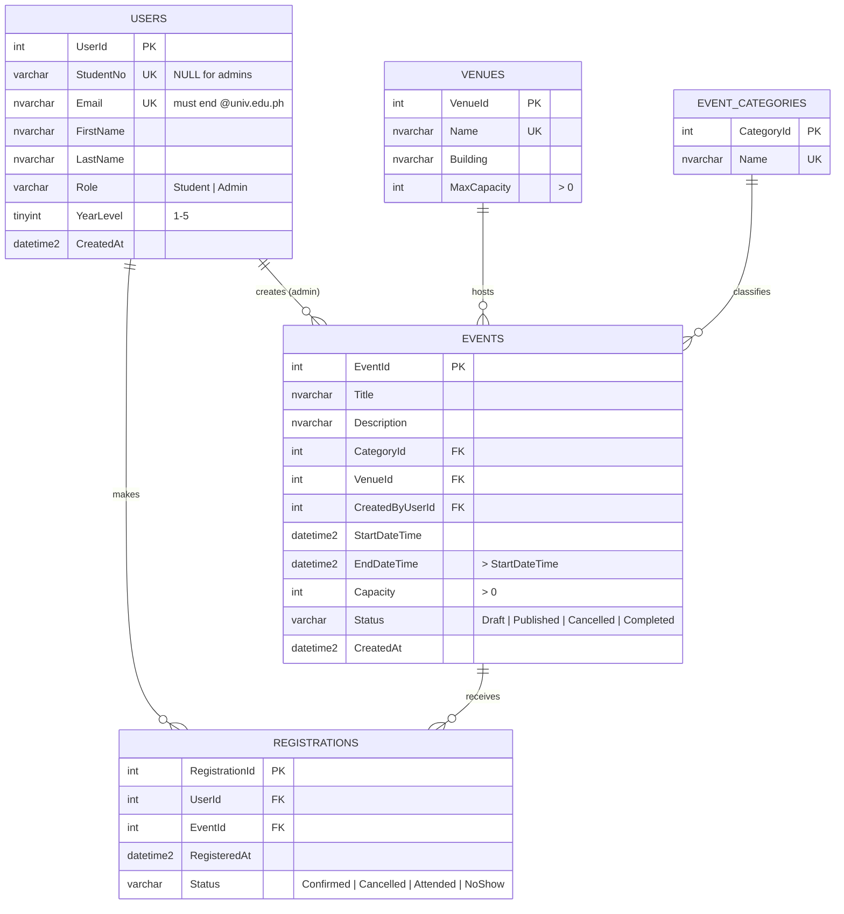

# Online Campus Event Management System: Laboratory Examination Submission

**Course:** Applied Generative AI for IT Solution Development
**Group:** _Lauron, Martin, Ng, Somuelo
**Repository:** _[GitHub URL]_

---

## Team Roster

| Member | Name | Assigned Role | Tasks Led |
|---|---|---|---|
| Member 1 | _Alarie Somuelo_ | Systems Architect & Prompt Lead | Task 1, Task 5 |
| Member 2 | _Aiven Allyson Martin_ | Frontend Engineer | Task 2 |
| Member 3 | _Patrick James Lauron_ | Database & Backend Engineer | Task 3 |
| Member 4 | _Paula Mitchel Ng_ | QA & Security Engineer | Task 4 |

---

## Setup Instructions

### Repository layout

/
├── SUBMISSION.md                  ← this report
├── frontend/                      ← Task 2: static UI (HTML5 + CSS + vanilla JS)
│   ├── index.html                 ← student page: catalog + registration
│   ├── admin.html                 ← staff page: registered attendees
│   ├── styles.css                 ← shared, mobile-first styles
│   ├── data.js                    ← shared data + localStorage persistence
│   ├── app.js                     ← student page logic
│   ├── admin.js                   ← admin page logic
│   └── images/                    ← event illustrations (SVG)
├── database/
│   └── schema.sql                 ← Task 3: 3NF DDL, FKs, CHECKs, indexes, seed data
├── backend/                       ← Task 4: C# (.NET 8) class library
│   ├── Backend.csproj
│   ├── RegistrationService.cs     ← refactored, injection-safe method
│   ├── RegistrationValidator.cs   ← validation routine under test
│   ├── IEventRepository.cs        ← abstraction that tests mock
│   └── SqlEventRepository.cs      ← production ADO.NET implementation
└── tests/Backend.Tests/           ← Task 4: xUnit + Moq unit tests

### 1. View the frontend (no install needed)

Open `frontend/index.html` in any modern browser (double-click it), or serve it:

```bash
cd frontend
python -m http.server 8080      # then open http://localhost:8080
```

Open `frontend/admin.html` (or use the "Staff login" link in the footer) to see attendees. The prototype saves registrations in the browser's localStorage, so they appear on the admin page and survive a reload. To reset, clear the site data in your browser.

### 2. Create the database

Requires SQL Server 2019+ (Developer/Express edition or Azure SQL) and SSMS or Azure Data Studio.

1. Open `database/schema.sql`.
2. Execute the whole script. It creates `CampusEventsDB`, all tables, indexes, the `vw_EventAttendees` view, and seed data. It is safe to re-run.
3. Check: `SELECT * FROM dbo.vw_EventAttendees;` should return 0 rows (no sample attendees are seeded).

### 3. Build the backend and run the unit tests

Requires the [.NET 8 SDK](https://dotnet.microsoft.com/download).

```bash
dotnet build backend/Backend.csproj
dotnet test  tests/Backend.Tests/Backend.Tests.csproj
```

The unit tests mock the database, so SQL Server does **not** need to be running for them.

To use `RegistrationService` against the real database, set the connection string as an environment variable (never commit it):

```bash
# Windows PowerShell
$env:CAMPUS_EVENTS_DB = "Server=localhost;Database=CampusEventsDB;Trusted_Connection=True;TrustServerCertificate=True"
```

---

## Task 1

### Production-grade prompt (RCTC framework)

```text
### ROLE
You are a Lead Systems Architect with 15 years of experience designing web systems
for universities. You mentor junior developers, so you favor simple, proven designs
over trendy ones and you explain trade-offs in plain language.

### CONTEXT
A team of 4 fourth-year BSIT students must build a working prototype of an
"Online Campus Event Management System" in a single 3-hour laboratory exam.
Roles: 1 systems architect, 1 frontend engineer, 1 database/backend engineer,
1 QA/security engineer. They work in parallel and merge into one GitHub repo.
Required features:
  1. Students view upcoming campus events.
  2. Students register for an event using their @univ.edu.ph email.
  3. Administrators view registered attendees per event.
Mandated stack: semantic HTML5/CSS/JavaScript frontend, C# (.NET 8) backend,
Microsoft SQL Server database. The frontend must meet basic WCAG 2.1 AA.

### TASK
Produce an overall system design containing:
  a. A one-paragraph architecture summary and a text component diagram.
  b. The main entities and their relationships (no full DDL).
  c. A minimal REST API endpoint list (method, route, purpose).
  d. Key validation and security rules.
  e. A 3-hour work breakdown showing what each role does in parallel.
  f. An explicit "out of scope for the prototype" list.

### CONSTRAINTS
- Do NOT use third-party state management libraries such as Redux or MobX.
- Do NOT use a frontend framework (React, Angular, Vue); use vanilla JavaScript.
- Do NOT use an ORM such as Entity Framework; use ADO.NET with parameterized queries only.
- Do NOT propose microservices, message queues, Docker, or cloud deployment.
- Do NOT hard-code credentials anywhere in the design.
- The design must be buildable by beginners in 3 hours; if a feature risks that, move it to "out of scope".
- Format the answer in Markdown with the headings a–f. Keep it under 700 words.
```

### AI output (verbatim)

> **Tool:** Claude (Anthropic). Response pasted without edits.

**a. Architecture summary**

A three-tier monolith: a static frontend (HTML5/CSS/vanilla JS) calls a small ASP.NET Core Web API, which reads and writes a SQL Server database through ADO.NET. Everything runs on one developer machine. The frontend can start on in-memory mock data so the UI work is never blocked waiting for the API.

[Browser: index.html + app.js]
        │  fetch() JSON over HTTP
        ▼
[ASP.NET Core Web API (.NET 8)]
   ├─ EventsController / RegistrationsController
   ├─ RegistrationValidator  (email domain + seat rules)
   └─ IEventRepository → SqlEventRepository (ADO.NET, parameterized)
        │
        ▼
[SQL Server: CampusEventsDB]

**b. Entities and relationships**

- **Users** (UserId, StudentNo, Email, FirstName, LastName, Role, YearLevel)
- **Venues** (VenueId, Name, Building, MaxCapacity)
- **EventCategories** (CategoryId, Name)
- **Events** (EventId, Title, Description, CategoryId, VenueId, CreatedByUserId, StartDateTime, EndDateTime, Capacity, Status)
- **Registrations** (RegistrationId, UserId, EventId, RegisteredAt, Status): the junction between Users and Events, UNIQUE(UserId, EventId).

Users 1–N Registrations N–1 Events; Events N–1 Venues; Events N–1 EventCategories; Users (Admin) 1–N Events created.

**c. REST endpoints**

| Method | Route | Purpose |
|---|---|---|
| GET | /api/events?upcoming=true | List published upcoming events with seats left |
| GET | /api/events/{id} | Event details |
| POST | /api/registrations | Register (body: email, studentNo, eventId) |
| GET | /api/admin/events/{id}/attendees | Admin: attendee list |

**d. Validation and security rules**

1. Email must match `^[A-Za-z0-9._%+-]+@univ\.edu\.ph$`, validated on both client and server.
2. Registration is rejected if the event is full, not published, or already registered (UNIQUE constraint as the final guard).
3. All SQL uses parameters; no string concatenation.
4. Connections are wrapped in `using` blocks.
5. Connection string comes from environment variables / user-secrets.
6. Admin endpoints require the Admin role (simplified to a header or a hard gate for the prototype; real authentication is out of scope).
7. Frontend renders data with `textContent`, never `innerHTML`, to prevent XSS.

**e. 3-hour work breakdown**

| Time | Architect (M1) | Frontend (M2) | DB/Backend (M3) | QA/Security (M4) |
|---|---|---|---|---|
| 0:00–0:30 | Prompt + design, agree API contract | Page skeleton | ERD | Test plan |
| 0:30–1:15 | Start SUBMISSION.md | Catalog + form with mock data | schema.sql | Validator + tests |
| 1:15–2:00 | Review PRs | Accessibility pass | Repository class | Security refactor |
| 2:00–2:45 | Integration | Wire to API if time allows | API endpoints | Run tests, review SQL |
| 2:45–3:00 | Final report | Final commit | Final commit | Final commit |

**f. Out of scope for the prototype**

Login/authentication (SSO), password storage, email confirmations, waitlists, payments, event image uploads, deployment, and real-time seat updates.

### Manual grounding evaluation

The proposed architecture is realistic for a 3-hour, four-person prototype because it is a single three-tier monolith using tools already required by the exam, and it deliberately excludes authentication, deployment and waitlists, which would not fit the time limit. The parallel work breakdown is sound since the frontend starts on mock data and the unit tests use a mocked repository, so no member waits on another. However, building the full ASP.NET Core API and wiring the frontend to it is optimistic for beginners in the final 45 minutes; in our submission the frontend runs on in-memory data and the backend is delivered as a tested class library, which we consider the realistic scope. We also verified the AI's claim that SQL Server does not auto-index foreign keys (it does not), which is why Task 3 adds those indexes explicitly.

---

## Task 2

### Prompt used

```text
Role: You are a senior frontend engineer and WCAG 2.1 AA accessibility specialist.
Context: Prototype UI for a university "Online Campus Event Management System". Students
browse upcoming events and register with an @univ.edu.ph email; admins view attendees.
Task: Build index.html, styles.css and app.js for an Event Catalog and Registration Form.
Constraints:
- Use semantic HTML5: <header>, <nav>, <main>, <section>, <article> (one per event), <footer>.
  Do not use <div> as a page-level wrapper where a semantic tag exists.
- Every input has a visible <label for>, an aria-label that contains the visible label text,
  aria-required, and aria-describedby pointing at its hint/error text.
- Every  has meaningful alt text.
- All text meets 4.5:1 contrast; state the ratios. Visible keyboard focus. Skip link.
- Errors are announced to screen readers and moved focus to the first invalid field.
- Vanilla JS only, no frameworks, no innerHTML with data (use textContent).
- Validate: email must end in @univ.edu.ph; block registration when seats are full.
```

### What was delivered (`/frontend`)

| Requirement | Where it is met |
|---|---|
| Semantic HTML5 | `<header>`, `<nav>`, `<main>`, three `<section>`s, one `<article>` per event, `<footer>`, `<time datetime>`, `<fieldset>`/`<legend>` for the radio group, `<table>` with `<caption>` and `scope="col"` |
| Form labels + `aria-label` | Every input/select has `<label for>` plus an `aria-label` whose text starts with the visible label (WCAG 2.5.3 Label in Name) |
| Error messaging | `aria-invalid`, `aria-describedby`, `role="alert"` error text, `role="status"` result, focus moved to the first invalid field |
| Contrast | All text pairs are 6.5:1 or higher; values are recorded at the top of `styles.css` |
| Image alt text | Each event illustration has a descriptive `alt` |
| Operable | Skip link, visible `:focus-visible` outline, 44px minimum touch targets, `prefers-reduced-motion` respected |
| Understandable | Plain-language hints ("Must end in @univ.edu.ph"), specific error messages |
| Robust | Valid HTML5, `lang="en"`, no ARIA used where native HTML already provides the semantics (except the required aria-labels) |

---

## Task 3

### Prompt used

```text
Role: You are a senior SQL Server database engineer.
Context: Campus Event Management System (students view and register for events; admins view
attendees). Target: Microsoft SQL Server 2019+.
Task:
1. Design a schema in Third Normal Form with at least these entities: Users, Events,
   Registrations. Split out any attribute that would create a transitive dependency.
2. Output an Entity-Relationship Diagram as a Mermaid.js erDiagram code block.
3. Output a production-grade, re-runnable T-SQL DDL script with:
   - PRIMARY KEY, UNIQUE and FOREIGN KEY constraints with explicit ON DELETE / ON UPDATE rules,
   - CHECK constraints (email domain @univ.edu.ph, positive capacity, end after start, status values),
   - a NONCLUSTERED INDEX on every foreign key column,
   - a view listing attendees per event, and seed data.
Constraints: Do not store derived values such as "seats left". Do not store the student's
email in Registrations. Explain in comments why the design is 3NF.
```

### Entity-Relationship Diagram (Mermaid.js)



### Why the schema is in 3NF

- **1NF:** every column holds one atomic value; no lists such as "attendees" stored in Events.
- **2NF:** every table uses a single-column surrogate key, so no partial dependency on part of a composite key is possible. The natural key (UserId, EventId) of Registrations is enforced as a UNIQUE constraint instead.
- **3NF:** no non-key column depends on another non-key column. Venue building and capacity live in `Venues`, not repeated on each event; category names live in `EventCategories`; a student's email and name live only in `Users`. "Seats left" is computed with `COUNT()` rather than stored, so it cannot go stale.

### DDL script

Saved as [`/database/schema.sql`](database/schema.sql). Highlights:

- **Foreign key rules:** `Registrations → Users/Events` use `ON DELETE CASCADE`; `Events → Venues/EventCategories/Users` use `ON DELETE NO ACTION` so in-use reference data and event creators cannot be deleted by accident.
- **CHECK constraints:** role and status value lists, `@univ.edu.ph` email pattern, student-number format `####-#####`, year level 1–5, capacity > 0, `EndDateTime > StartDateTime`, and "students must have a StudentNo and YearLevel".
- **Non-clustered indexes on all five FK columns:** `IX_Events_CategoryId`, `IX_Events_VenueId`, `IX_Events_CreatedByUserId`, `IX_Registrations_UserId`, `IX_Registrations_EventId` (covering), plus `IX_Events_Status_Start` for the catalog query.

---

## Task 4

### 4.1 Unit test generation prompt

```text
Role: You are a QA engineer practicing shift-left testing in C# (.NET 8).
Context: RegistrationValidator depends on IEventRepository (GetEventCapacity,
GetConfirmedRegistrationCount, IsAlreadyRegistered), which talks to SQL Server.
Task: Write xUnit unit tests for (1) IsValidStudentEmail and (2) Validate(email, eventId).
Constraints:
- Use Moq with MockBehavior.Strict to isolate the database; no real connections.
- Follow Arrange-Act-Assert. One behavior per test; descriptive names.
- Cover: valid emails, case/whitespace, non-university domains, suffix spoofing
  (x@univ.edu.ph.evil.com), look-alike domains (x@fakeuniv.edu.ph), SQL-injection-style
  input, over-length input, seats available, exactly full, event not found, duplicate
  registration, and verify the repository is NOT called when the email is invalid.
```

**Result:** [`/tests/Backend.Tests/RegistrationValidatorTests.cs`](tests/Backend.Tests/RegistrationValidatorTests.cs) contains 10 test methods (22 test cases once `[Theory]` rows are expanded). `Mock<IEventRepository>` replaces the database; `VerifyAll`, `Verify(..., Times.Never)` and `VerifyNoOtherCalls` prove the validator only queries the database when it needs to. [`RegistrationServiceTests.cs`](tests/Backend.Tests/RegistrationServiceTests.cs) adds guard-clause tests showing injection strings are rejected before a connection is opened.

### 4.2 Vulnerability diagnosis prompt

```text
Role: You are an application security reviewer (OWASP Top 10) and senior C# developer.
Context: The following ADO.NET method is from a campus event registration backend.
Task: Identify every security vulnerability, resource/memory leak and reliability bug.
For each: name it, show how it can be exploited or fail, rate severity, and give the fix.
Then provide a refactored version.
Constraints: Use parameterized queries with explicit SqlDbType; use `using` statements;
do not hard-code credentials; do not use string concatenation or string interpolation in SQL.

[flawed GetUserRegistration method pasted here]
```

### 4.3 AI diagnosis output (verbatim)

> **Tool:** Claude (Anthropic).

| # | Issue | Severity | How it fails | Fix |
|---|---|---|---|---|
| 1 | **SQL injection** (OWASP A03) | Critical | `inputEmail = "' OR '1'='1"` makes the WHERE clause always true; `'; DROP TABLE Registrations;--` can run arbitrary statements if the login has permission. | Parameterized query: `WHERE Email = @Email`, value sent separately with `SqlDbType.NVarChar, 255`. |
| 2 | **Connection leak** | High | `SqlConnection` is opened but never closed or disposed. Each call holds a pooled connection until the garbage collector finalizes it; under load the pool (default 100) is exhausted and requests fail with a timeout. | `using var conn = new SqlConnection(...)`. |
| 3 | **Undisposed `SqlCommand`** | Medium | Holds unmanaged resources until finalization. | `using var cmd = new SqlCommand(...)`. |
| 4 | **Hard-coded credentials** (OWASP A07/A05) | High | Password is committed to Git and visible to anyone with repo access. | Inject the connection string from configuration / environment variables. |
| 5 | **NullReferenceException** | Medium | `ExecuteScalar()` returns `null` when no row matches, so `.ToString()` crashes. | Check for `null` and `DBNull`; return `string?`. |
| 6 | **`SELECT *` with `ExecuteScalar`** | Low | Only column 1 of row 1 is returned; result depends on column order and arbitrary row order. | Select the exact column with `TOP (1)` and `ORDER BY`. |
| 7 | **No input validation** | Low | Any string reaches the database. | Validate the email format first (defense in depth, not a replacement for parameters). |

### 4.4 Refactored solution

Saved as [`/backend/RegistrationService.cs`](backend/RegistrationService.cs). Core of the fix:

```csharp
public string? GetUserRegistration(string inputEmail)
{
    if (!RegistrationValidator.IsValidStudentEmail(inputEmail))
        throw new ArgumentException("A valid @univ.edu.ph email is required.", nameof(inputEmail));

    const string sql = @"
        SELECT TOP (1) r.RegistrationId
        FROM dbo.Registrations AS r
        INNER JOIN dbo.Users AS u ON u.UserId = r.UserId
        WHERE u.Email = @Email
        ORDER BY r.RegisteredAt DESC;";

    using var conn = new SqlConnection(_connectionString);   // injected, not hard-coded
    using var cmd  = new SqlCommand(sql, conn);
    cmd.Parameters.Add("@Email", SqlDbType.NVarChar, 255).Value = inputEmail.Trim();

    conn.Open();
    object? result = cmd.ExecuteScalar();
    return result is null || result is DBNull ? null : result.ToString();
}
```

An `async` version (`GetUserRegistrationAsync`, using `await using`) is included for ASP.NET Core use.

---

## Task 5

### AI Disclosure Statement

We used the following generative AI tools during this examination:

| Tool | Used for | Tasks |
| Claude (Anthropic) | System design, UI code, schema/ERD/DDL, unit tests, vulnerability diagnosis and refactoring, report drafting | 1, 2, 3, 4, 5 |

**How outputs were verified:**


1. **Frontend:** opened the page in a browser and at a 390px mobile width; tested keyboard-only navigation (Tab, Shift+Tab, Enter, Space); submitted invalid and valid data; recomputed every color-contrast ratio with the WCAG relative-luminance formula; _[add: ran axe DevTools / WAVE / Lighthouse accessibility audit and recorded the score]_.
2. **Database:** executed `schema.sql` on SQL Server, re-ran it to confirm it is idempotent, tried inserts that must fail (non-university email, capacity 0, end before start, duplicate registration) and confirmed each was rejected by the right constraint.
3. **Backend/tests:** ran `dotnet build` and `dotnet test`; attempted the injection payload `' OR '1'='1` against the refactored method.
4. **Report:** every AI claim quoted in this file was checked against the actual code in the repository.

No AI output was committed without a group member reading and testing it. All final decisions were made by the group.

### Group Verification Log

<!-- TEAM: keep only rows your team actually checked. Replace "Member X" with the real person
     who verified the fix, and add any other issues you found yourselves. -->

| Task # | Identified AI Flaw / Limitation | Manual Correction Applied | Member Responsible |
|---|---|---|---|
| Task 1 | AI design assumed a full ASP.NET Core API wired to the UI within 3 hours, which is optimistic for our team. | Scoped the prototype: frontend runs on in-memory data; backend delivered as a tested class library. Documented in the grounding evaluation. | Member 1 |
| Task 2 | First draft gave `aria-label` text that did not match the visible labels (e.g. radio labelled "1st" but announced as "First year"; filter labelled "Show category" but announced as "Filter events by category"), failing WCAG 2.5.3 Label in Name for voice-control users. | Rewrote each `aria-label` to begin with its visible label text; changed radio labels to "1st year" etc. | Member 2 |
| Task 2 | Color-contrast ratios written in the CSS comment were estimates and several were wrong (e.g. ink on yellow stated 10.9:1, actual 10.3:1). | Recomputed every pair with the WCAG luminance formula and corrected the comment; all pairs still pass AA. | Member 2 |
| Task 2 | Admin attendee dropdown jumped back to the first event after every new registration (state was lost on re-render). | Preserved the selected value when the dropdown is rebuilt; retested. | Member 2 |
| Task 2 / 3 | AI added made-up sample attendees ("Maria Santos", "Jose Reyes") to the admin list and the database seed data, so the attendee list showed people who never registered. | Removed the sample registrations from `frontend/data.js` and `database/schema.sql`; the list now starts empty and only shows real sign-ups. | Member 2 / Member 3 |
| Task 3 / 4 | The exam's flawed query filters `Registrations` by `Email`, but in a 3NF design the email belongs only in `Users`; a straight AI "fix" of the query would fail against our schema. | Rewrote the query to `JOIN dbo.Users` on `UserId`. | Member 3 |
| Task 4 | A plain parameterized refactor still crashed with `NullReferenceException` when no registration exists, and still used `SELECT *` with `ExecuteScalar`. | Added `null`/`DBNull` handling, `string?` return type, `TOP (1) ... ORDER BY`, and selected only `RegistrationId`. | Member 4 |

---

## Known Limitations

- The frontend is not yet connected to the backend; it uses in-memory sample data.
- No authentication: the "Attendees (admin)" section is visible to everyone in the prototype.
- Seat counting and inserting are separate steps; production code should insert inside a transaction (or use a `SERIALIZABLE` check) to prevent two students taking the last seat at the same time.
